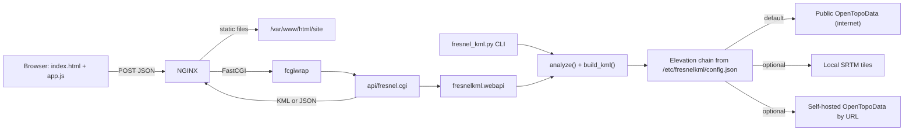

# Implementation plan: Fresnel KML web service

This plan implements [SPEC.md](SPEC.md) as a web service. You copy a self-contained folder into the NGINX web root; it holds a static page and a Python FastCGI API. You POST JSON describing two sites and get KML back. The same core package also provides the spec's command-line tool and library API.

## Architecture
NGINX serves the static page from the drop-in folder. Requests to the API go to fcgiwrap, which runs a Python CGI script stored in the same folder. That script imports the `fresnelkml` package, which is also copied into the folder, so the server needs nothing installed beyond `python3`. The command-line tool and the library API use the same package.



Install target: `/var/www/html/site`, served at the URL prefix `/site/`. The page calls the API with a relative URL, so the folder works under any prefix or path.

## Source layout (this repository)
The spec calls the CLI `fresnel_kml.py`. A package can't have that same name: running the script from the repo root would make `import fresnel_kml` import the script itself. So the core is a package named `fresnelkml/`.

- `fresnel_kml.py`: CLI wrapper; calls `fresnelkml.cli.main()`
- `fresnelkml/fresnel.py`: wavelength, zone radius, maximum radius, earth bulge
- `fresnelkml/geo.py`: distance, bearing, path stations, conversion from local offsets to lat/lon, longitude normalisation. Uses `pyproj.Geod` when installed and haversine otherwise.
- `fresnelkml/elevation.py`: the `ElevationProvider` interface, the HTTP providers and the per-point fallback chain
- `fresnelkml/local_hgt.py`: offline SRTM tile reader
- `fresnelkml/config.py`: loads the server config and builds the elevation chain
- `fresnelkml/analysis.py`: `Site`, `Options`, `LinkReport` (with `to_dict()` for JSON), `analyze()`
- `fresnelkml/colors.py`: zone color parsing, conversion to KML `aabbggrr`, and the random pick
- `fresnelkml/kml.py`: `build_kml()`, written with ElementTree
- `fresnelkml/parsing.py`: site strings, DMS coordinates, CSV and JSON request objects, validation, feet conversion
- `fresnelkml/cli.py`: argparse flags from spec section 5 and the stdout summary table
- `fresnelkml/webapi.py`: `handle_request(method, headers, body, env) -> (status, headers, body)`. It has no CGI or HTTP-server dependency, so the CGI script, the dev server and the tests all call it the same way.
- `web/index.html`, `web/app.js`, `web/style.css`: the page (vanilla JavaScript, no build step)
- `web/api/fresnel.cgi`: about 30 lines. It adds `../lib` to `sys.path`, reads `REQUEST_METHOD`, `CONTENT_TYPE` and `CONTENT_LENGTH` plus the request body from stdin, calls `handle_request`, and writes CGI headers and the body to stdout. It doesn't use the stdlib `cgi` module, which was removed in Python 3.13.
- `tools/build_site.py`: assembles `dist/site/` and `dist/fresnel-site.tar.gz`
- `tools/dev_server.py`: local `wsgiref` server that serves `web/` and sends `/api/fresnel.cgi` to `handle_request`
- `tools/fetch_hgt.py`: one-time download of elevation tiles for a region
- `deploy/nginx-fresnel.conf`, `deploy/INSTALL.md`, `deploy/config.example.json`
- `pyproject.toml`: `requests` and `pyproj` are optional extras, `pytest` is a dev dependency, and `fresnel_kml` is a console script

## Drop-in folder (`dist/site/`, copied to `/var/www/html/site/`)
```
site/
  index.html
  app.js
  style.css
  api/fresnel.cgi          (executable, #!/usr/bin/env python3)
  lib/fresnelkml/*.py      (copied package; NGINX blocks direct access)
  VERSION
```

Third-party dependencies: the HTTP layer uses `requests` when it can be imported and falls back to the stdlib `urllib.request` otherwise. So the folder needs no pip install and no copied wheels, and there's no risk of shipping compiled wheels that don't match the server's CPU or Python version. `pyproj` is optional in the same way.

## One-time server setup (documented in deploy/INSTALL.md)
1. `apt install nginx fcgiwrap python3`. fcgiwrap provides `/run/fcgiwrap.socket`.
2. Add the snippet from `deploy/nginx-fresnel.conf` to the server block, then run `nginx -t && systemctl reload nginx`:

```nginx
location /site/lib/ { deny all; }
location = /site/api/fresnel.cgi {
    client_max_body_size 16k;
    fastcgi_read_timeout 60s;
    include fastcgi_params;
    fastcgi_param SCRIPT_FILENAME $document_root$fastcgi_script_name;
    # fastcgi_param GOOGLE_ELEVATION_KEY "...";   # optional
    fastcgi_pass unix:/run/fcgiwrap.socket;
}
```

3. Optional: create `/etc/fresnelkml/config.json` from `deploy/config.example.json` to add local tiles or a self-hosted OpenTopoData server. For local tiles, run `tools/fetch_hgt.py` and make the tile folder readable by `www-data`. With no config file, the server uses the public internet sources.
4. After that, deploying or upgrading is just `tar xzf fresnel-site.tar.gz -C /var/www/html/`. Nothing needs restarting after an upgrade, because each request starts a fresh Python process.

## API
`POST /site/api/fresnel.cgi` with `Content-Type: application/json`:

```json
{
  "site_a": {"name": "TowerA", "lat": 37.0, "lon": -122.0, "agl_m": 30, "ground_m": null},
  "site_b": {"name": "TowerB", "lat": "37°03'00\"N", "lon": -121.9, "asl_m": 412.5},
  "options": {"freq_ghz": 5.8, "zone": 1, "sixty": true, "k": 1.3333, "clutter_m": 0,
              "elev_source": "auto",
              "stations": 64, "ring_points": 24, "style": "mesh",
              "terrain_check": true, "mode": "absolute", "units": "m",
              "color": "random"},
  "format": "kml"
}
```

- Every key in `options` is optional and defaults to the spec value. Latitude and longitude can be decimal degrees or DMS strings.
- Each site gives exactly one of `agl_m` or `asl_m` (see "Antenna height reference"). Giving both, or neither, is a `400` error.
- `elev_source` is `"auto"` (use the server's configured chain) or the `name` of one entry in that chain, which limits the lookup to that source. An unknown name is a `400` error. Clients can't add sources or URLs; only the server config can.
- `color` sets the color of the Fresnel zone shape (see "Zone color"). It defaults to `"random"`. The chosen color is returned in `report.zone_color`.
- With `"format": "kml"` (the default), the response is `200`, `Content-Type: application/vnd.google-earth.kml+xml` and `Content-Disposition: attachment; filename="Fresnel_TowerA_TowerB.kml"`. The filename is sanitised.
- With `"format": "json"`, the response is `{"kml": "...", "report": {distance, bearings, r1_max, r60, min_clearance, status, zone_color, sites: [...], elevation_sources, profile: [...]}, "warnings": [...]}`. The web page uses this format so it can show a summary and offer the download.
- `GET api/fresnel.cgi?sources` returns the names and types of the configured elevation sources, never their URLs or paths.
- Errors always come back as JSON `{"error": "...", "field": "..."}`:
  - `400`: bad input
  - `405`: method other than POST or GET; a plain `GET` returns a short usage message
  - `413`: body too large
  - `502`: every elevation source failed; the message suggests giving `asl_m`, or `ground_m`, for each site and turning off `terrain_check`
- Server-side limits: `stations` at most 512, `ring_points` at most 72, body at most 16 KB, and the request must finish within 45 s.
- The Google API key is read only from the server environment (`GOOGLE_ELEVATION_KEY` via `fastcgi_param`); a key sent in the request is ignored.
- Example: `curl -X POST -H 'Content-Type: application/json' -d @req.json https://host/site/api/fresnel.cgi -o link.kml`

## Web page
- Inputs for each site: name, latitude, longitude (decimal degrees or DMS), a height value, and a "Height is: above ground / above sea level" toggle (default: above ground). The optional ground-elevation override field is only shown for "above ground".
- A hint under the toggles. If both sites use above sea level and the terrain check is off, it says no elevation lookup will be made.
- A "Zone color" control: a "Random" checkbox, checked by default, next to an `<input type="color">` picker. The picker is disabled while "Random" is checked.
- A collapsible "Advanced" section with the remaining options, including an "Elevation source" dropdown filled from `GET api/fresnel.cgi?sources`.
- The page sends `format: "json"`. It then shows:
  - a summary card: distance, bearings, maximum r1, 0.6·r1, minimum clearance, a CLEAR/MARGINAL/BLOCKED badge, a swatch and hex value for the zone color used, and any warnings
  - a "Download KML" button built from a Blob
  - a terrain-profile sketch in an inline SVG, drawn from `report.profile`, showing ground, line of sight, the zone bottom and the 60% line
- A short "API" section shows the JSON request format and the curl example.
- Plain HTML, CSS and JavaScript. No CDN, no framework, no external assets, so the page works fully offline from the folder.

## Core design
- `Site(name, lat, lon, agl_m=None, ground_m=None, asl_m=None)` is a dataclass. Exactly one of `agl_m` and `asl_m` must be set. `Options` holds every setting with the spec defaults: 5.8 GHz, zone 1, the 60% zone on, k = 4/3, clutter 0, 64 stations, 24 ring points, mesh style, absolute mode.
- `analyze()` works out each site's antenna height above sea level (see "Antenna height reference"). It then computes the distance, both bearings, the stations, the line-of-sight altitude at each station, the zone radius and bulge at each station, and (if enabled) path terrain, clearance and status. It returns a `LinkReport`. `build_kml()` only renders.
- Two separate station counts:
  - Mesh: exactly N stations, so test T8's rule "polygon count = N·M" holds.
  - Terrain check: N_t = max(N, ceil(D/250 m), 16), capped at 512.
- Mesh:
  - At each station, one ring of M points using the spec's east/north/up frame.
  - Between rings i and i+1, one closed 5-coordinate quad per ring point. At the two end stations the radius is 0, so those spans become triangles (a closed ring of 4 coordinates).
  - All polygons go in one `MultiGeometry` with no `extrude` or `tessellate`.
  - The `rings` style writes ring `LineString`s only.
- Coordinates are written as `lon,lat,alt` with `%.7f,%.7f,%.2f`. ElementTree handles XML escaping.
- Description balloons show frequency, wavelength, distance, both bearings, maximum r1, 0.6·r1, minimum clearance and status, and the ground / AGL / ASL / elevation source for each site.

### Antenna height reference
- `asl_m`: the antenna height above sea level, given directly. The site needs no elevation lookup.
  - If `ground_m` is also given, AGL is reported as `asl_m − ground_m`. A negative result is a `400` error.
  - Otherwise ground and AGL are reported as unknown. The mast is drawn as an absolute `Point` with `<extrude>1</extrude>`, so Google Earth draws the line down to its own terrain without needing a ground value.
  - `mode: "relative"` needs AGL, so a site given as ASL with no ground value is a `400` error in that mode.
  - Range check: −500 m to 9000 m.
- `agl_m`: the height above ground, as in the spec. Ground comes from `ground_m` if given, otherwise from the elevation chain.
- An elevation lookup happens only for sites given as AGL without `ground_m`, or for the terrain check.
  - ASL heights remove the lookup for the towers, but the terrain check always needs path elevations from some source.
  - The terrain check defaults to on only when some lookup is already needed. So two ASL sites, or two AGL sites with ground values, make no network or disk lookups unless the request sets `terrain_check: true`.
- `units: "ft"` converts `agl_m`, `asl_m`, `ground_m` and clutter. The key names keep the `_m` suffix for a stable API; in feet mode the numbers are read as feet.
- CLI:
  - Site heights take a suffix: `--a "TowerA,37.0,-122.0,30"` or `30agl` means AGL, and `412.5asl` means ASL.
  - CSV input accepts either an `agl_m` or an `asl_m` column; each row fills one of them.
- Reports and balloons record each site's height reference and where its ground value came from: `given ASL`, `manual`, or the provider name, for example `opentopodata:ned10m` or `local_hgt`.

### Zone color
- Accepted values (case-insensitive):
  - `"random"` (the default)
  - `"#RRGGBB"`: the spec's default opacity of about 35% (alpha `0x59`) is applied
  - `"#RRGGBBAA"`: explicit alpha
  - a named color: green, blue, cyan, magenta, purple, pink, white, orange, red or yellow
- Anything else is a `400` error with `field: "options.color"`. The CLI exits non-zero.
- Input uses the familiar web `#RRGGBB` order; `colors.py` converts it to KML `aabbggrr` (for example, `#00FF00` becomes `5900ff00`).
- Random color:
  - Hue is drawn uniformly from 75° to 330°, so the zone never looks like the yellow line of sight, the orange 60% zone or the red obstruction markers.
  - Saturation is 0.65 to 1.0 and value is 0.75 to 1.0, so the color stays vivid.
  - The color is picked once per request, inside `analyze()`, and stored in the report, so the KML and the JSON report always agree.
  - `analyze()` takes an optional `rng: random.Random` so tests are deterministic.
- The color applies to the main zone's `PolyStyle` in mesh style. In rings style it applies to the `LineStyle`, at full opacity so the wireframe is visible. The 60% zone stays orange `6600a5ff`.
- The zone Placemark description includes `Zone color: #RRGGBB (random)` or `(chosen)`.
- CLI: `--color random|#RRGGBB|#RRGGBBAA|NAME`, default `random`.

## Elevation sources (server-configured chain)
The server operator sets the elevation chain in a JSON config file. The default is an internet lookup. A local-data source or a self-hosted OpenTopoData server can be added as a fallback, or put first, by editing that file.

- Config location: `/etc/fresnelkml/config.json`. NGINX can override the path with `fastcgi_param FRESNEL_CONFIG /path/config.json`; the CLI uses `--config PATH`.
  - The file lives outside the web folder, so upgrading the folder never overwrites it and it's never served over HTTP.
  - If the file is missing, the built-in default below is used, so a fresh install works with no config at all.
- Built-in default (internet):

```json
{
  "elevation": {
    "chain": [
      {"name": "opentopodata", "type": "opentopodata",
       "url": "https://api.opentopodata.org/v1", "datasets": "ned10m,srtm30m",
       "batch": 100, "min_interval_s": 1.0},
      {"name": "open-elevation", "type": "open-elevation",
       "url": "https://api.open-elevation.com/api/v1/lookup"}
    ],
    "timeout_s": 10, "retries": 2, "cache_dir": null
  }
}
```

- Example: internet first, with local tiles and a self-hosted OpenTopoData server as fallbacks:

```json
{"elevation": {"chain": [
  {"name": "opentopodata", "type": "opentopodata", "url": "https://api.opentopodata.org/v1",
   "datasets": "ned10m,srtm30m", "batch": 100, "min_interval_s": 1.0},
  {"name": "local", "type": "local_hgt", "path": "/var/lib/fresnelkml/hgt"},
  {"name": "mesh-otd", "type": "opentopodata", "url": "http://10.0.0.5:5000/v1",
   "datasets": "srtm30m", "batch": 500, "min_interval_s": 0}
]}}
```

  - For fully offline use, the chain is just the `local` entry, or just a LAN OpenTopoData entry.
- Source types:
  - `opentopodata`: any server with the OpenTopoData API, set by `url`. This covers both the public instance and a self-hosted one.
    - `datasets` is a comma-separated list. OpenTopoData falls back per point when a dataset has no data there, so `ned10m,srtm30m` needs no "is this point in the US?" check.
    - `batch` and `min_interval_s` are set per server, because a self-hosted server has no public rate limit.
  - `local_hgt`: reads SRTM `.hgt` or `.hgt.gz` tiles named like `N37W122.hgt` from `path`.
    - The tile resolution comes from the file size: 3601² samples (1 arc-second, about 30 m) or 1201² samples (3 arc-seconds, about 90 m).
    - Big-endian int16 values are read with `struct`/`mmap` and bilinearly interpolated. The void value −32768 counts as "no data".
    - A point whose tile is missing also counts as "no data", so that point falls through to the next source.
    - Plain Python only; no GDAL.
  - `open-elevation`, `usgs` and `google` work as in the spec, with configurable `url`. `google` reads its key from `key_env` (default `GOOGLE_ELEVATION_KEY`).
- Fallback is per point: each source gets the points still missing after the sources before it. A source that still errors after `retries` attempts is skipped.
  - If points are still missing after the whole chain, the request fails with `502` (CLI: non-zero exit).
  - The exception is a null over water from a source that does cover the point. That is treated as 0 m with a warning, as in the spec.
- CLI shortcuts that build a one-off chain without a config file: `--elev-provider`, `--opentopodata-url URL`, `--dataset`, `--hgt-dir DIR`. They are applied in the order given on the command line.
- `tools/fetch_hgt.py --bbox S,W,N,E --out /var/lib/fresnelkml/hgt`:
  - Downloads 1 arc-second SRTM tiles for a region once, from the public AWS terrain tiles bucket (`elevation-tiles-prod/skadi/N37/N37W122.hgt.gz`).
  - Prints the tile count and size before downloading.
  - Decompresses tiles by default, so lookups can read the files in place; `--keep-gz` keeps them compressed.
  - This is the only step in offline mode that needs the internet, and it can be run on another machine and the files copied over.
- The public OpenTopoData limits (1 request/s, 1000/day) are shared by every user of this server, so:
  - Each source's `min_interval_s` is enforced across concurrent CGI processes with an `fcntl` lock file in the system temp directory.
  - When `cache_dir` is set and writable (for example `/var/cache/fresnelkml`, owned by `www-data`), lookups are cached on disk, keyed by source name, dataset and coordinates rounded to 5 decimal places.
  - INSTALL.md suggests an NGINX `limit_req` zone on the API location.

### Local tile storage example: Oregon and Washington
These sizes were measured from the AWS tile bucket in November 2026. The area is latitudes 42°N to 49°N and longitudes 117°W to 125°W, which is 63 tiles of 1° × 1°.

| Storage | Per tile | 63 tiles |
|---|---|---|
| 1 arc-second (about 30 m), `.hgt.gz` | 2.2 to 16 MB (about 10 MB on average) | 652 MB |
| 1 arc-second (about 30 m), `.hgt` | 25.9 MB | 1.63 GB |
| 3 arc-seconds (about 90 m), `.hgt` | 2.9 MB | about 180 MB |

- Adding one ring of tiles as a border margin (99 tiles) brings it to about 2.6 GB uncompressed or about 1 GB compressed.
- Uncompressed is recommended. Each CGI request is a fresh process, so a compressed tile would be fully decompressed on every request.

## Decisions on spec gaps and conflicts
1. Test T11's expected value is wrong. A 0.02° longitude step is about 2.2 km × cos(lat), not 1.1 km. The test uses the corrected value.
2. Antimeridian conflict. The spec says to add 360 to negative longitudes when a quad spans more than 180°, but test T11 requires every output longitude to be in range. Each vertex is normalised to (−180, 180]; the 360 shift applies only inside a polygon that would otherwise span more than 180°.
3. Manual ground override versus the terrain check (test T12). This is covered by the rule in "Antenna height reference": the terrain check defaults to on only when a lookup is already needed.
4. `units: "ft"` converts every height input and clutter.
5. `mode: "relative"` affects only the tower placemarks and points; the line of sight and the zone stay absolute, and a warning is returned.
6. Above 85° latitude, offsets come from `Geod.fwd`. Without pyproj, a spherical forward formula is used with a warning.

## Tests (pytest, elevation providers always mocked)
- T1 to T5 in `test_fresnel.py`; T6, T7 and T11 in `test_geo.py`
- T8 and T9 in `test_kml.py`; T10 in `test_analysis.py`; T12 in `test_elevation.py`
- `test_parsing.py`: the spec's edge cases, plus height inputs:
  - exactly one of `agl_m`/`asl_m`
  - the `asl`/`agl` suffixes in CLI site strings
  - both kinds of CSV height column
  - feet conversion of `asl_m`
  - `asl_m − ground_m < 0` is rejected
  - relative mode with ASL and no ground is rejected
- `test_heights.py`:
  - two ASL sites with the terrain check left at its default: the HTTP and file-access mocks both assert no lookups happen
  - one ASL site and one AGL site: exactly one site lookup
  - two ASL sites with `terrain_check: true`: only path lookups
  - the KML mast for an ASL site with no ground is an extruded `Point`
- `test_elevation_chain.py`:
  - a missing config file gives the built-in internet chain
  - config parsing, and unknown source types rejected
  - a custom `opentopodata` `url` is the one actually requested (mocked)
  - per-point fallback: the internet mock fails and `local_hgt` fills in; the reverse case; points still missing after the whole chain give `502`
  - `elev_source` restricts the chain to one entry, and an unknown name gives `400`
  - `GET ?sources` returns no URLs or paths
- `test_local_hgt.py`:
  - builds small synthetic tiles in a temp directory (real 1201² size, generated with `array`) and checks bilinear values at corners, edges and centre
  - void handling, `.hgt.gz` reading, and southern/western hemisphere tile names
- `test_colors.py`:
  - `#00FF00` converts to `5900ff00`, and `#00FF0080` to `8000ff00`
  - named colors resolve correctly
  - invalid values are rejected
  - with a seeded RNG, 1000 random picks all have a hue in [75°, 330°) and saturation and value within range
  - the zone style in the KML matches `report.zone_color`
- `test_api.py`:
  - JSON request to KML response: checks headers and that the body parses as XML
  - `format: "json"` returns the expected report fields
  - errors: 400 for bad fields, 405, 413, and 502 when the provider mock fails
  - the KML download filename is sanitised
  - a Google key sent in the request is ignored
- `test_site_tree.py`:
  - Runs `tools/build_site.py` into a temp directory, then runs the built `api/fresnel.cgi` as a subprocess with CGI environment variables and a JSON body on stdin.
  - It uses two ASL sites and `FRESNEL_CONFIG` pointing to a chain with only `local_hgt` over synthetic tiles, so there's no network access.
  - It checks the CGI headers and the KML body, which proves the folder is self-contained.
- Manual acceptance:
  - Open a KML generated by the web page in Google Earth Pro: the zone should be centred on the line of sight, touch the tower tops, and be semi-transparent.
  - Check the deployed site with a curl call through NGINX.

## Implementation steps
1. Scaffold: `pyproject.toml`, the `fresnelkml/` package skeleton, the `fresnel_kml.py` wrapper, `web/`, `deploy/` and `tests/`.
2. `fresnel.py` and tests T1 to T5.
3. `geo.py` and tests T6, T7 and T11.
4. `parsing.py` (site strings, DMS, CSV, JSON request objects, validation, feet conversion) and edge-case tests.
5. `elevation.py`: HTTP helper, providers with configurable URLs, per-point fallback chain, retries, cross-process throttle, optional cache; test T12.
6. `config.py`, `deploy/config.example.json` and `test_elevation_chain.py`.
7. `local_hgt.py`, `tools/fetch_hgt.py` and `test_local_hgt.py`.
8. Height reference support (`agl_m` or `asl_m`) and `test_heights.py`.
9. `analysis.py` (LinkReport, clearance, status, warnings) and test T10.
10. `colors.py` and `test_colors.py`.
11. `kml.py` and tests T8 and T9.
12. `cli.py`.
13. `webapi.py`, `web/api/fresnel.cgi` and `test_api.py`.
14. The web page: `index.html`, `app.js`, `style.css`.
15. `tools/build_site.py`, `tools/dev_server.py`, `deploy/nginx-fresnel.conf`, `deploy/INSTALL.md` and `test_site_tree.py`.
16. README: what the service does, API reference with a curl example, CLI usage, building the folder, local development, deployment, and the Google Earth Pro acceptance checklist.
